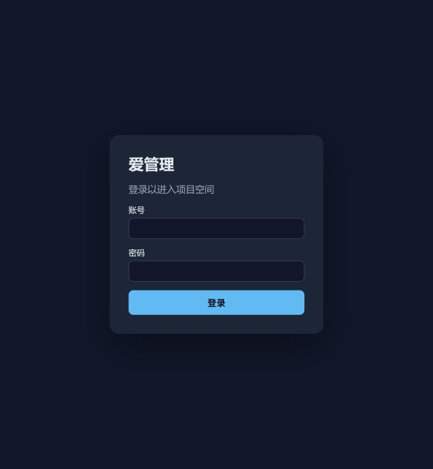
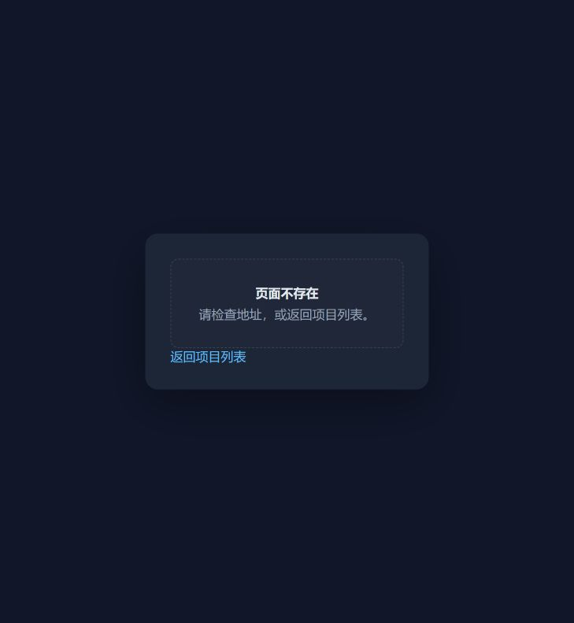

# 前端审查问题清单（2026-09-25）

## 范围与证据

本次按 `/audit` 检查本地 React 前端。已实际打开并截图：① 登录页，② 未知地址的 404 页，③ 未登录直达 `/projects/new` 后的登录回跳。登录后的项目、成员、需求和任务页面因本地演示账号登录尚未获自动审批放行，仅检查当前工作区代码；这些问题标为「代码确认，交互待复核」。工作区相关源码已有未提交修改，本报告反映审查时的当前状态。

1. 登录页：页面可见且表单具有账号、密码标签；状态为「可用，后续流程待验证」。
2. 未知地址：显示“页面不存在”和返回项目列表链接；状态为「可用，有语义结构问题」。
3. 未登录直达新建项目：正确跳转到 `/login?redirect=%2Fprojects%2Fnew`；状态为「回跳参数已验证，登录后回跳待验证」。

## 问题

| 编号 | 优先级 | 位置与证据 | 问题及影响 | 建议 |
|---|---|---|---|---|
| F01 | 高 | `web/src/pages/task/TaskSection.tsx:188-194,286-290`；代码确认，交互待复核 | “删除”直接调用 `deleteTask`，没有二次确认。误点会立即删除任务。 | 使用项目已有的 `ConfirmDialog`，显示任务标题，确认后才提交。 |
| F02 | 高 | `web/src/pages/ProjectMembersPage.tsx:64-70,101-109`；代码确认，交互待复核 | “移除”直接请求后端，没有确认或撤销入口，可能误移除成员。 | 增加带成员姓名的确认步骤，并在请求期间禁用该行操作。 |
| F03 | 中 | `web/src/layouts/ProjectLayout.tsx:30-35,45-54`；代码确认，交互待复核 | `getProject` 的所有失败都会显示“项目不存在或无权访问”。网络故障和服务端错误被误报为 404，用户也没有重试入口。 | 仅将实际 404 显示为无权/不存在；其他错误显示加载失败和重试。 |
| F04 | 中 | `web/src/pages/ProjectListPage.tsx:19-25,44-52`、`web/src/pages/ProjectTasksPage.tsx:40-46,68-75`；代码确认，交互待复核 | 加载失败后仍渲染“还没有项目”或“没有任务”，与错误提示并存。空数据与请求失败被混淆。 | 为失败和空数据使用互斥状态；失败时保留重试操作。 |
| F05 | 中 | `web/src/pages/ProjectOverviewPage.tsx:51-59`；代码确认，交互待复核 | 概览仍显示“需求/任务将在 Sprint 后续接入”，但路由已包含对应页面。过时提示会误导使用者。 | 改为当前数量、入口或明确的空状态。 |
| F06 | 中 | `web/src/pages/task/TaskSection.tsx:68-70,73-77,125-129`；代码确认，交互待复核 | 表单在缺项或日期不合法时禁用“保存”，而详细的 `hint` 只在提交处理器运行后才出现。用户无法通过点击按钮获得具体错误原因。 | 在字段附近实时说明未通过的条件，或允许提交后展示明确的字段错误。 |
| F07 | 中 | `web/src/index.css:275-280,364-378`；代码确认，移动端待复核 | 工作台固定为 200px 侧栏加内容栏，普通表格无横向滚动容器；全局样式没有窄屏布局规则。小屏可能出现内容挤压或横向溢出。 | 在窄屏将侧栏改为顶部/折叠导航，并为宽表提供可滚动容器；用 320px/375px 视口验证。 |
| F08 | 中 | `web/src/pages/ProjectMembersPage.tsx:80-88`、`web/src/pages/task/TaskSection.tsx:260-274`；代码确认，辅助技术待复核 | 表格每行的角色或状态下拉框没有带成员/任务名称的可访问名称；读屏用户难以区分正在修改哪一行。 | 为控件加 `aria-label` 或关联可见行标题，如“修改张工的角色”。 |
| F09 | 低 | `web/src/components/EmptyState.tsx:4-9`；截图②与代码确认 | 404 页的“页面不存在”用 `<strong>` 而非标题元素；该页没有可导航的标题层级。 | 为页面级空状态使用 `<h1>`，普通列表空状态使用适当级别的标题。 |

## 验证边界

- 已验证：上述三个公开页面的实际渲染，以及未登录访问受保护地址的回跳 URL。
- 未验证：登录后的页面截图、写操作实际结果、手机视口重排、键盘完整流程与读屏表现。F01–F08 的交互影响以代码路径为依据，仍需在授权登录后实测。
- 本次只新增此问题清单及三张证据截图；未修改应用代码或数据。
